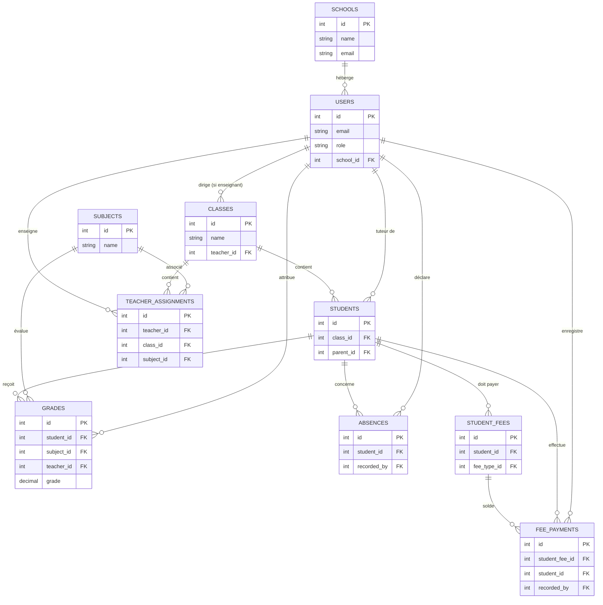

# Modèle Logique de Données (MLD) — EduSuivi

Ce document formalise la structure de la base de données relationnelle de l'application **EduSuivi**, détaillant comment les tables communiquent via les mécanismes de clés primaires (**PK**) et clés étrangères (**FK**), y compris les modifications introduites avec la fonctionnalité Multi-École ([migration_v5.sql](../sql/migration_v5.sql)).

---

## 1. Concepts Clés
- **Clé Primaire (Primary Key - PK)** : Identifiant unique et immuable d'un enregistrement dans sa propre table (ex: `id`).
- **Clé Étrangère (Foreign Key - FK)** : Attribut qui fait référence à la clé primaire d'une autre table, établissant ainsi une relation d'intégrité référentielle entre les deux.

---

## 2. Représentation Textuelle du MLD

Voici la formalisation des tables sous forme de schéma logique de données (les clés primaires sont en **gras** et soulignées, les clés étrangères sont suivies de `#` avec mention de la table cible) :

* **schools** (<u>id</u>, name, address, phone, email, logo, created_at)
* **users** (<u>id</u>, name, email, password, role, reset_token, reset_token_expiry, created_at, *school_id#* -> schools.id)
* **classes** (<u>id</u>, name, level, max_students, room, school_year, *teacher_id#* -> users.id)
* **subjects** (<u>id</u>, name)
* **students** (<u>id</u>, matricule, first_name, last_name, date_of_birth, gender, option_filiere, phone, address, photo, school_year, *class_id#* -> classes.id, *parent_id#* -> users.id)
* **teacher_assignments** (<u>id</u>, *teacher_id#* -> users.id, *class_id#* -> classes.id, *subject_id#* -> subjects.id)
* **grades** (<u>id</u>, grade, max_grade, period, comment, created_at, *student_id#* -> students.id, *subject_id#* -> subjects.id, *teacher_id#* -> users.id)
* **absences** (<u>id</u>, date, justified, reason, created_at, *student_id#* -> students.id, *subject_id#* -> subjects.id, *recorded_by#* -> users.id)
* **announcements** (<u>id</u>, title, content, target, created_at, *author_id#* -> users.id, *target_class_id#* -> classes.id)
* **messages** (<u>id</u>, subject, body, is_read, is_deleted_sender, is_deleted_receiver, created_at, *sender_id#* -> users.id, *receiver_id#* -> users.id)
* **agenda_events** (<u>id</u>, title, description, event_type, event_date, event_time, end_date, target, created_at, *target_class_id#* -> classes.id, *created_by#* -> users.id)
* **fee_types** (<u>id</u>, name, amount, description, school_year, is_active)
* **student_fees** (<u>id</u>, amount_due, school_year, created_at, *student_id#* -> students.id, *fee_type_id#* -> fee_types.id)
* **fee_payments** (<u>id</u>, amount_paid, payment_method, transaction_ref, payment_date, receipt_number, notes, created_at, *student_fee_id#* -> student_fees.id, *student_id#* -> students.id, *recorded_by#* -> users.id)
* **user_preferences** (<u>*user_id#*</u> -> users.id, lang, theme, notifications_enabled, updated_at)

---

## 3. Diagramme Entité-Relation (Mermaid)

Ce diagramme illustre le flux relationnel et les liens physiques entre les tables de [database.sql](../sql/database.sql) :

---

## 4. Analyse des Relations Majeures

### A. Multi-École : `schools` ➔ `users`
* **Type** : 1 à N (Un-à-plusieurs)
* **Mécanisme** : La clé primaire `schools.id` est propagée comme clé étrangère `users.school_id`. 
* **Règle de Gestion** : Un administrateur ou directeur appartient à une seule école (la FK pointe sur une seule ligne de `schools`), mais une école peut regrouper plusieurs utilisateurs (enseignants, administrateurs).

### B. Scolarité : `students` ➔ `classes` et `users` (Parents)
* **Type** : 1 à N
* **Mécanisme** : `students.class_id` pointe vers `classes.id` (association à une classe unique). `students.parent_id` pointe vers `users.id` (association à un compte tuteur de rôle `parent`).

### C. Évaluation : `grades` (Table d'association triple)
* **Type** : Table de faits associant 3 dimensions.
* **Mécanisme** : Elle lie un élève (`student_id`), une matière (`subject_id`), et l'enseignant qui a corrigé (`teacher_id`).
